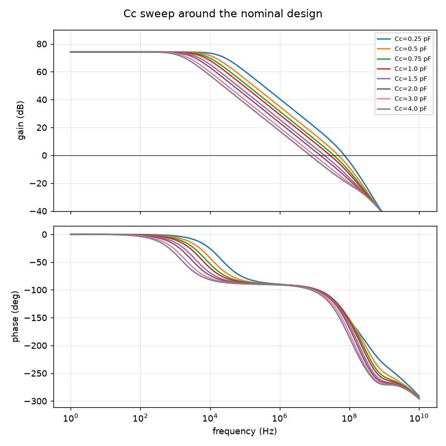

# SPICE-Verified Fine-Tuning and Reinforcement Learning for Analog Amplifier Design

A small specialist language model looks at a failing two-stage op-amp design and decides what to change next. It is trained and graded only by a circuit simulator (ngspice), then used inside an agent that repairs designs step by step.
**Research question:** can a small, privately runnable model, trained only on simulator feedback, choose better design moves than a large general model?

## Roadmap
| Phase | Scope | Status |
|---|---|---|
| 1 | Simulation environment: netlist, simulator, actions, specs, batch + cache, Drive sync | **Done** |
| 2 | Simulator-labeled dataset: rank all actions per failing start state, split by start design | Not started |
| 3 | Eval harness, LoRA fine-tune of a small open model, baselines (large model via Groq) | Not started |
| 4 | Multi-step agent, traces, failure taxonomy and recovery, one round of expert iteration | Not started |

## Phase 1 results
Circuit: Miller-compensated two-stage op-amp (NMOS diff pair, PMOS mirror, PMOS common-source second stage), CL = 2 pF, VDD = 1.8 V. Open-loop AC is measured with a DC-feedback loop-break (see `docs/DECISIONS.md`).

Hand-sized nominal design (simulated): **DC gain 74.2 dB, UGF 27.9 MHz, phase margin 67.8°, power 0.44 mW, all 8 devices saturated.**
Throughput: about 165 simulations/s uncached on a MacBook Air M4 (9 workers).

Cc sweep (more Cc: more phase margin, lower UGF):



What each action does to the nominal design (from `results/action_effects.csv`):

| action | Δgain (dB) | ΔPM (deg) | UGF ratio | power ratio |
|---|---|---|---|---|
| cc_up / cc_down | 0.0 / 0.0 | +3.9 / -4.7 | 0.79 / 1.25 | 1.00 / 1.00 |
| ibias_up / ibias_down | -2.3 / +2.3 | +0.2 / -0.1 | 1.13 / 0.88 | 1.30 / 0.77 |
| w_in_up / w_in_down | +1.1 / -1.1 | -2.8 / +2.5 | 1.13 / 0.88 | 1.00 / 1.00 |
| l_in_up / l_in_down | -0.3 / +0.2 | +2.6 / -2.9 | 0.88 / 1.14 | 1.00 / 1.00 |
| l_load_up / l_load_down | +1.1 / -1.3 | -0.6 / +0.4 | 1.00 / 1.00 | 1.00 / 1.00 |
| w_cs_up / w_cs_down | +1.1 / -1.1 | +1.4 / -1.7 | 1.00 / 1.00 | 1.00 / 1.00 |
| out_ratio_up / out_ratio_down | -1.1 / +1.1 | +1.6 / -2.0 | 1.00 / 1.00 | 1.24 / 0.81 |

## Limitations
Devices are SPICE Level-1 models (lambda ∝ 1/L), not a BSIM/PTM card (the PTM site was unreachable when this was built). They show the right trends but ignore short-channel effects, so absolute numbers are not silicon-accurate.

## Run Phase 1
Requires Python ≥ 3.10 and ngspice (`brew install ngspice`).
```bash
python3 -m venv .venv && source .venv/bin/activate
pip install -e .
pytest
python scripts/simulate_one.py      # nominal design report
python scripts/explore_cc.py        # Cc sweep: table, figure, CSV
python scripts/explore_actions.py   # what each of the 14 actions does
# data/phase2 is committed to git; Colab results come back as a zip: python scripts/import_results_zip.py <zip>
```
Design decisions are logged in [docs/DECISIONS.md](docs/DECISIONS.md). `notebooks/00_colab_bootstrap.ipynb` checks Colab's ngspice against the Mac's.
