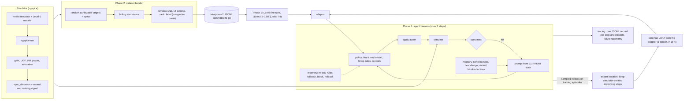

# SPICE-Verified Fine-Tuning and Reinforcement Learning for Analog Amplifier Design

A small specialist language model looks at a failing two-stage op-amp design and decides what to change next. It is trained and graded only by a circuit simulator (ngspice), then used inside an agent that repairs designs step by step.
**Research question:** can a small, privately runnable model, trained only on simulator feedback, choose better design moves than a large general model?

## Roadmap
| Phase | Scope | Status |
|---|---|---|
| 1 | Simulation environment: netlist, simulator, actions, specs, batch + cache, Drive sync | **Done** |
| 2 | Simulator-labeled dataset: rank all actions per failing start state, split by start design | **Done** |
| 3 | Eval harness, LoRA fine-tune of a small open model, baselines (large model via Groq) | **Done** |
| 4 | Multi-step agent, traces, failure taxonomy and recovery, one round of expert iteration | **Done** |

## Phase 1 results
Circuit: Miller-compensated two-stage op-amp (NMOS diff pair, PMOS mirror, PMOS common-source second stage), CL = 2 pF, VDD = 1.8 V. Open-loop AC is measured with a DC-feedback loop-break (see `docs/DECISIONS.md`).

Hand-sized nominal design (simulated): **DC gain 74.2 dB, UGF 27.9 MHz, phase margin 67.8°, power 0.44 mW, all 8 devices saturated.**
Throughput: about 165 simulations/s uncached on a MacBook Air M4 (9 workers).

Cc sweep (more Cc: more phase margin, lower UGF):


What each action does to the nominal design (from `results/action_effects.csv`):

| action | Δgain (dB) | ΔPM (deg) | UGF ratio | power ratio |
|---|---|---|---|---|
| cc_up / cc_down | 0.0 / 0.0 | +3.9 / -4.7 | 0.79 / 1.25 | 1.00 / 1.00 |
| ibias_up / ibias_down | -2.3 / +2.3 | +0.2 / -0.1 | 1.13 / 0.88 | 1.30 / 0.77 |
| w_in_up / w_in_down | +1.1 / -1.1 | -2.8 / +2.5 | 1.13 / 0.88 | 1.00 / 1.00 |
| l_in_up / l_in_down | -0.3 / +0.2 | +2.6 / -2.9 | 0.88 / 1.14 | 1.00 / 1.00 |
| l_load_up / l_load_down | +1.1 / -1.3 | -0.6 / +0.4 | 1.00 / 1.00 | 1.00 / 1.00 |
| w_cs_up / w_cs_down | +1.1 / -1.1 | +1.4 / -1.7 | 1.00 / 1.00 | 1.00 / 1.00 |
| out_ratio_up / out_ratio_down | -1.1 / +1.1 | +1.6 / -2.0 | 1.00 / 1.00 | 1.24 / 0.81 |

## Phase 3 results: LoRA fine-tune vs a large model

**Setup.** Qwen2.5-0.5B-Instruct with a LoRA adapter (r=16, all attention and MLP projections), trained 2 epochs (366 steps, 19.3 min on a free T4, fp16) on 2926 simulator-labeled states. The loss is on the reply only. Every method sees the same prompt and is scored by lookup into the simulator's precomputed outcome of every action, so no model output is ever re-simulated. Intervals are 95% bootstrap CIs over states. Full details are in [docs/DECISIONS.md](docs/DECISIONS.md) (D16-D24) and the numbers in [results/phase3_results.md](results/phase3_results.md).

**Main comparison: 150-example eval subset** (a fixed, step-stratified sample of the test split, so the Groq models could be run on exactly the same states):

| method | n | valid | top-1 tie-aware (95% CI) | top-1 exact | top-3 | improvement rate (95% CI) | mean regret (95% CI) |
|---|---|---|---|---|---|---|---|
| random | 150 | 1.000 | 0.107 [0.097, 0.118] | 0.073 | 0.230 | 0.401 [0.381, 0.419] | 0.243 [0.204, 0.282] |
| majority action | 150 | 1.000 | 0.313 [0.247, 0.387] | 0.293 | 0.393 | 0.480 [0.400, 0.553] | 0.097 [0.080, 0.115] |
| textbook rules | 150 | 1.000 | 0.400 [0.320, 0.480] | 0.287 | 0.733 | 0.880 [0.827, 0.927] | 0.073 [0.050, 0.102] |
| Groq openai/gpt-oss-120b | 150 | 0.987 | 0.513 [0.433, 0.593] | 0.447 | 0.627 | 0.827 [0.767, 0.887] | 0.103 [0.072, 0.141] |
| Groq qwen/qwen3.8-27b | 150 | 1.000 | 0.333 [0.260, 0.407] | 0.253 | 0.493 | 0.787 [0.720, 0.847] | 0.179 [0.128, 0.233] |
| Qwen2.5-0.5B base model (untrained) | 150 | 1.000 | 0.187 [0.127, 0.253] | 0.167 | 0.213 | 0.273 [0.200, 0.347] | 0.211 [0.168, 0.259] |
| Qwen2.5-0.5B fine-tuned | 150 | 1.000 | 0.693 [0.620, 0.760] | 0.627 | 0.740 | 0.873 [0.820, 0.920] | 0.056 [0.033, 0.082] |

**Full test split** (375 examples; the Groq models were only run on the subset):

| method | n | valid | top-1 tie-aware (95% CI) | top-1 exact | top-3 | improvement rate (95% CI) | mean regret (95% CI) |
|---|---|---|---|---|---|---|---|
| random | 375 | 1.000 | 0.117 [0.109, 0.125] | 0.073 | 0.232 | 0.406 [0.395, 0.417] | 0.232 [0.208, 0.258] |
| majority action | 375 | 1.000 | 0.325 [0.280, 0.373] | 0.304 | 0.389 | 0.464 [0.416, 0.515] | 0.092 [0.081, 0.103] |
| textbook rules | 375 | 1.000 | 0.440 [0.392, 0.488] | 0.261 | 0.768 | 0.904 [0.875, 0.933] | 0.070 [0.055, 0.088] |
| Qwen2.5-0.5B base model (untrained) | 375 | 1.000 | 0.173 [0.133, 0.211] | 0.157 | 0.213 | 0.261 [0.216, 0.307] | 0.203 [0.175, 0.235] |
| Qwen2.5-0.5B fine-tuned | 375 | 1.000 | 0.717 [0.669, 0.763] | 0.661 | 0.803 | 0.893 [0.861, 0.923] | 0.042 [0.028, 0.059] |

Training curve (loss on reply tokens; the reply is a JSON action plus a short generated reason, so the loss mixes action choice with reason text):


**Where each method wins or loses** (subset; top-1 / improvement rate / regret). By step, the fine-tuned model is strongest on first-look designs (step 0: 0.75 / 0.93 / 0.028) and weakest at step 3 (0.36 / 0.64 / 0.187, but only n=11). By largest shortfall, it is clearly ahead on UGF (0.71 top-1 vs 0.23 for textbook rules) and gain (0.78 vs 0.22), and behind textbook rules on phase margin (0.56 vs 0.75). The full breakdown is in `results/phase3_results.md`.

**Interpretation.** On this task a 0.5B model fine-tuned only on simulator labels picks the best move far more often than the untrained model (0.693 vs 0.187 tie-aware top-1) and more often than gpt-oss-120b (0.513) and the textbook rules (0.400); its mean regret (0.056) is the lowest of all methods. The gain is in choosing the *best* move, not in choosing a *helpful* one: its improvement rate (0.873) is statistically tied with textbook rules (0.880, CIs overlap almost entirely), which already find a move that helps about 88% of the time. The margin over gpt-oss-120b is clear but not huge at n=150 (top-1 CIs [0.620, 0.760] vs [0.433, 0.593] just separate; the regret CIs still overlap), and the full-test result (0.717, n=375) points the same way. Caveats: the evaluation is in-distribution (the same circuit and spec generator, with unseen designs, split by target), the task is single-step (Phase 4 tests the multi-step agent), and the circuit uses Level-1 device models, so this shows the approach works against a simulator, not that these numbers hold on silicon-accurate models or other topologies.

## Phase 4 results: a multi-step agent with recovery, and one round of expert iteration

**Architecture**



**Setup.** The same Qwen2.5-0.5B LoRA model from Phase 3 is now used as an agent: from a failing design it takes up to 8 steps; each step it sees the same prompt format it was trained on (built from the *current* design), picks one action, the harness applies it and ngspice simulates it, and the episode ends when the simulator says every spec passes. The agent's memory (best design so far, visited designs, blocked actions) lives in the harness, so prompts stay in the training distribution. Every step and episode is traced to JSONL with a failure taxonomy (INVALID_OUTPUT, UNAVAILABLE_ACTION, SIM_FAILURE, LOOP, NO_PROGRESS, BUDGET_EXHAUSTED) and four recovery paths (re-ask then rules fallback, block-and-re-ask on loops, rollback on simulation failure, rollback to the best design on no progress). Test set: 174 failing designs from 60 unseen targets. Full tables are in [results/phase4_results.md](results/phase4_results.md); two readable traces are in [results/phase4/examples.md](results/phase4/examples.md).

**Main table: all 174 test episodes, 8-step budget** (95% bootstrap CIs; "steps / reference path" compares steps used with the number of inverse lattice moves that built each start state):

| agent | n | success (95% CI) | median steps to success | steps / reference path (solved) | mean final distance | sims / episode | invalid-output rate | recoveries / episode |
|---|---|---|---|---|---|---|---|---|
| random | 174 | 0.282 [0.218, 0.351] | 3.0 | 0.67 | 0.564 | 6.2 | 0.000 | 0.00 |
| random + recovery | 174 | 0.339 [0.270, 0.414] | 4.0 | 0.77 | 0.295 | 6.7 | 0.000 | 1.59 |
| textbook rules | 174 | 0.759 [0.690, 0.822] | 2.5 | 0.53 | 0.077 | 4.0 | 0.000 | 0.00 |
| textbook rules + recovery | 174 | 0.753 [0.690, 0.816] | 2.0 | 0.53 | 0.038 | 3.6 | 0.032 | 0.49 |
| fine-tuned Qwen2.5-0.5B | 174 | 0.782 [0.718, 0.845] | 2.0 | 0.41 | 0.026 | 2.3 | 0.000 | 0.00 |
| fine-tuned + recovery | 174 | 0.902 [0.856, 0.948] | 2.0 | 0.46 | 0.011 | 2.9 | 0.000 | 0.67 |
| after expert iteration + recovery | 174 | 0.943 [0.908, 0.977] | 2.0 | 0.45 | 0.009 | 2.7 | 0.000 | 0.39 |


**Recovery ablation** (same episodes, paired bootstrap CI on the difference):

| comparison | n | success: no recovery | success: recovery | paired difference (95% CI) |
|---|---|---|---|---|
| random | 174 | 0.282 [0.218, 0.351] | 0.339 [0.270, 0.414] | +0.057 [-0.017, +0.138] |
| textbook rules | 174 | 0.759 [0.690, 0.822] | 0.753 [0.690, 0.816] | -0.006 [-0.017, +0.000] |
| fine-tuned Qwen | 174 | 0.782 [0.718, 0.845] | 0.902 [0.856, 0.948] | +0.121 [+0.075, +0.167] |

**Expert iteration, before vs after** (agent with recovery): success 0.902 [0.856, 0.948] -> 0.943 [0.908, 0.977], a paired difference of +0.040 [+0.006, +0.075]. The round sampled 1408 rollouts (704 train episodes x 2, temperature 0.8) and the simulator marked 1293 as solved (91.8%). From those, 3002 improving steps the model chose itself were candidates; 1196 were exact duplicates of Phase 2 examples and were dropped, leaving **1579 new examples** (303 at step 0, 1276 at later steps) added to the 2926 original ones for one epoch at lr 1e-4 from the Phase 3 adapter (15.4 min on the T4). The single-step test eval barely moved (top-1 0.717 -> 0.731, CIs overlap; regret 0.042 -> 0.040), so there was no regression, and most of the agent gain is in recovering from its own mistakes, not in better first moves.

**What the failure classes show.** The fine-tuned model without recovery has *no* invalid outputs but **194 LOOP events**: it is stateless, so when a move takes it back to a design it has already seen, it picks the same move again. Blocking the looping action and re-asking (a one-line change to the action list) cuts LOOP events to **82**, and success rises from 0.782 to 0.902. After expert iteration LOOP events fall again to **47**, budget-exhausted episodes from 38 to 13 to 8: training on its own successful trajectories made the model loop less, not just score better.

**Efficiency vs the textbook rules.** The fine-tuned agent with recovery solves 0.902 of episodes using 2.9 simulations per episode, against 0.759 for rules at 4.0 (3.6 with recovery). Per solved episode it needs 2.45 simulations vs 2.85 for rules, and it uses about 0.45 steps per reference-path move (rules: 0.53). Without recovery the fine-tuned agent is statistically tied with the rules (0.782 vs 0.759, paired difference +0.023 [-0.034, +0.080]); with recovery it is clearly ahead (+0.144 [+0.075, +0.207]), and after expert iteration +0.184 [+0.121, +0.253] (the agent solves 35 episodes the rules miss, and misses 3 the rules solve). The whole Colab run took about 34 minutes of compute on a free T4 (agents 4.4 min, rollouts 12.4 min, RL training 15.4 min, evals 2.1 min).

**Caveats.**
- **In-distribution:** test episodes are unseen designs, but they come from the same circuit and spec generator as the training data, and every start state is guaranteed solvable (it is at most 6 inverse moves from a design that meets its spec). A real design problem may have no solution in this action set.
- **Small, one-round RL gain with no negative signal:** +0.040 is real but small (the lower CI bound is +0.006). It is filtered behavior cloning on one round of the model's own successes, with no negative signal from failures, no value function and no second round. The rollouts were on *training* episodes, whose step-0 states the model had already been trained on, so their 91.8% success is optimistic; that is also why 1196 candidate steps were exact duplicates.
- **No gpt-oss agent result:** the gpt-oss-120b agent was stopped by Groq's 200,000 tokens/day cap and a lock-step run that aborts scores nothing, so no number is reported (its 58 cached responses allow a resume). The qwen3.8-27b agent was run instead on a fixed 30-episode subset: 0.600 [0.433, 0.767] without recovery and 0.833 [0.700, 0.967] with recovery, against 0.933 for the fine-tuned agent with recovery on the same 30 episodes. With n=30 the intervals overlap, so this pilot is inconclusive.
- **Re-asks do not consume steps:** a recovery re-ask happens inside a step, so the recovering agents get slightly more model calls per step than the budget implies; policy calls per episode and simulations per episode are reported to keep the comparison honest.
- **Level-1 device models, one topology, nominal corner:** the circuit is a single two-stage Miller op-amp simulated with simplified (Level-1) devices at one temperature and supply, so these success rates say nothing yet about silicon-accurate models, other topologies or PVT corners.

**What I would do next.**
1. Resume the gpt-oss-120b agent on the 30 cached episodes when the daily cap resets, and extend to all 174.
2. A second and third expert-iteration round, or a policy-gradient step that also learns from failures (for example reward-weighted or DPO-style pairs from good and bad moves of the same state).
3. Put the agent's recent history into the prompt and retrain, to see whether the model can learn loop-avoidance itself instead of relying on the harness.
4. Evaluate out of distribution: unseen spec ranges, other topologies, PVT corners and a BSIM model card.
5. Make the action set continuous (sized moves) and add a cost term for simulations used.

## Limitations
Devices are SPICE Level-1 models (lambda ∝ 1/L), not a BSIM/PTM card (the PTM site was unreachable when this was built). They show the right trends but ignore short-channel effects, so absolute numbers are not silicon-accurate.

## Run Phase 1
Requires Python ≥ 3.10 and ngspice (`brew install ngspice`).
```bash
python3 -m venv .venv && source .venv/bin/activate
pip install -e .
pytest
python scripts/simulate_one.py      # nominal design report
python scripts/explore_cc.py        # Cc sweep: table, figure, CSV
python scripts/explore_actions.py   # what each of the 14 actions does
# data/phase2 is committed to git; Colab results come back as a zip: python scripts/import_results_zip.py <zip>
```
Design decisions are logged in [docs/DECISIONS.md](docs/DECISIONS.md). `notebooks/00_colab_bootstrap.ipynb` checks Colab's ngspice against the Mac's.
