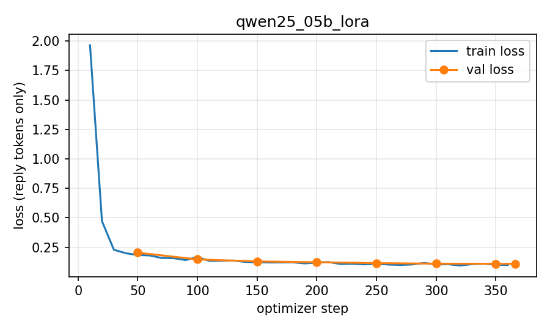
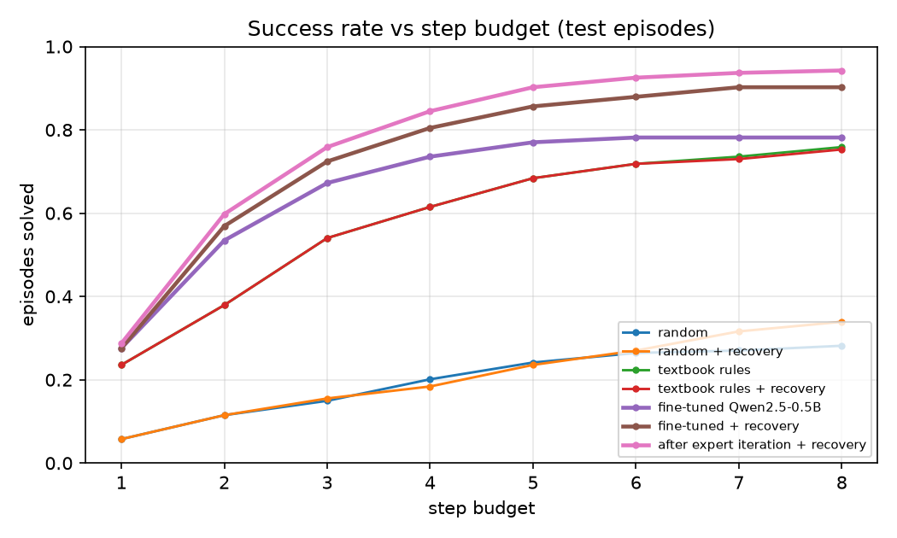

# SPICE-Verified Fine-Tuning and Reinforcement Learning for Analog Amplifier Design

A small language model that looks at a failing two-stage op-amp design and chooses the next design change. It is trained and graded only by a circuit simulator (ngspice) and then used inside an agent that repairs designs step by step, with tracing, failure detection, recovery paths and one round of expert iteration.

**Research question:** can a small, privately runnable model, trained only on simulator feedback, choose better design moves than a large general model?

## Results at a glance

**Single-step move selection** (150 held-out states; tie-aware top-1, 95% bootstrap CI):

| method | top-1 | improvement rate | mean regret |
|---|---|---|---|
| Qwen2.5-0.5B, LoRA fine-tuned on simulator labels | **0.693** [0.620, 0.760] | 0.873 | **0.056** |
| gpt-oss-120b (Groq, medium reasoning) | 0.513 [0.433, 0.593] | 0.827 | 0.103 |
| textbook rules | 0.400 [0.320, 0.480] | 0.880 | 0.073 |
| Qwen2.5-0.5B, untrained | 0.187 [0.127, 0.253] | 0.273 | 0.211 |

**Multi-step agent** (174 unseen test episodes, 8-step budget, success = the simulator reports every spec met):

| agent | success (95% CI) | simulations / episode |
|---|---|---|
| textbook rules | 0.759 [0.690, 0.822] | 4.0 |
| fine-tuned Qwen2.5-0.5B | 0.782 [0.718, 0.845] | 2.3 |
| fine-tuned + recovery paths | 0.902 [0.856, 0.948] | 2.9 |
| after one round of expert iteration + recovery | **0.943** [0.908, 0.977] | 2.7 |

Recovery adds +0.121 (paired 95% CI [+0.075, +0.167]); expert iteration adds +0.040 ([+0.006, +0.075]). Loop events fall from 194 to 82 to 47 across the three fine-tuned agents. Caveats are listed under [Limitations](#limitations).

## Architecture


Pipeline: the **simulator** (netlist template, Level-1 device models, ngspice, typed failures, parallel cached batches) defines a scalar spec distance. The **dataset builder** creates achievable specs, failing start states and, for every state, simulates all 14 actions to rank and label them. **LoRA SFT** (TRL + PEFT, loss on the reply only) trains a 0.5B model on those labels. An **evaluation harness** scores any model by lookup into the precomputed action outcomes. The **agent** applies the model repeatedly on live states, simulating every move, with a JSONL trace and a failure taxonomy; **recovery paths** react to invalid output, loops, failed simulations and stalls. **Expert iteration** retrains on the agent's own simulator-verified successes.

## Phase 1: simulation environment

Miller-compensated two-stage op-amp (NMOS differential pair, PMOS mirror load, PMOS common-source second stage), CL = 2 pF, VDD = 1.8 V. Open-loop AC is measured with a DC-feedback loop break ([D3](docs/DECISIONS.md)). The hand-sized nominal design simulates to **74.2 dB gain, 27.9 MHz UGF, 67.8 deg phase margin, 0.44 mW, all 8 devices saturated**. Throughput is about 165 simulations/s uncached on a MacBook Air M4 (9 workers).


Effect of each action on the nominal design (`results/action_effects.csv`):

| action | Δgain (dB) | ΔPM (deg) | UGF ratio | power ratio |
|---|---|---|---|---|
| cc_up / cc_down | 0.0 / 0.0 | +3.9 / -4.7 | 0.79 / 1.25 | 1.00 / 1.00 |
| ibias_up / ibias_down | -2.3 / +2.3 | +0.2 / -0.1 | 1.13 / 0.88 | 1.30 / 0.77 |
| w_in_up / w_in_down | +1.1 / -1.1 | -2.8 / +2.5 | 1.13 / 0.88 | 1.00 / 1.00 |
| l_in_up / l_in_down | -0.3 / +0.2 | +2.6 / -2.9 | 0.88 / 1.14 | 1.00 / 1.00 |
| l_load_up / l_load_down | +1.1 / -1.3 | -0.6 / +0.4 | 1.00 / 1.00 | 1.00 / 1.00 |
| w_cs_up / w_cs_down | +1.1 / -1.1 | +1.4 / -1.7 | 1.00 / 1.00 | 1.00 / 1.00 |
| out_ratio_up / out_ratio_down | -1.1 / +1.1 | +1.6 / -2.0 | 1.00 / 1.00 | 1.24 / 0.81 |

## Phase 2: simulator-labeled dataset

600 random designs that meet their own (slackened) specs become targets; start states are targets pushed 2-6 action-lattice moves away; every available action is simulated from each state, ranked by spec-distance improvement and labeled (ties broken by the largest margin beyond the spec). Result: **3679 labeled states** from 1758 start states and 600 targets, 55,236 simulations, split 2926 / 378 / 375 by target (no leakage). See [docs/DATASET_CARD.md](docs/DATASET_CARD.md).

## Phase 3: LoRA fine-tuning vs a large model

Qwen2.5-0.5B-Instruct with a LoRA adapter (r=16, all attention and MLP projections, 8.8M trainable parameters), 2 epochs (366 steps, 19.3 min on a free T4, fp16), trained on 2926 labeled states with loss on the reply only. Every method receives the same prompt and is scored by lookup into the simulator's outcome for every action, so no model output is re-simulated. Intervals are 95% bootstrap CIs over states.

**Eval subset** (150 test examples, stratified by step; the Groq models were run on exactly these):

| method | n | valid | top-1 tie-aware (95% CI) | top-1 exact | top-3 | improvement rate (95% CI) | mean regret (95% CI) |
|---|---|---|---|---|---|---|---|
| random | 150 | 1.000 | 0.107 [0.097, 0.118] | 0.073 | 0.230 | 0.401 [0.381, 0.419] | 0.243 [0.204, 0.282] |
| majority action | 150 | 1.000 | 0.313 [0.247, 0.387] | 0.293 | 0.393 | 0.480 [0.400, 0.553] | 0.097 [0.080, 0.115] |
| textbook rules | 150 | 1.000 | 0.400 [0.320, 0.480] | 0.287 | 0.733 | 0.880 [0.827, 0.927] | 0.073 [0.050, 0.102] |
| Groq openai/gpt-oss-120b | 150 | 0.987 | 0.513 [0.433, 0.593] | 0.447 | 0.627 | 0.827 [0.767, 0.887] | 0.103 [0.072, 0.141] |
| Groq qwen/qwen3.8-27b | 150 | 1.000 | 0.333 [0.260, 0.407] | 0.253 | 0.493 | 0.787 [0.720, 0.847] | 0.179 [0.128, 0.233] |
| Qwen2.5-0.5B base model (untrained) | 150 | 1.000 | 0.187 [0.127, 0.253] | 0.167 | 0.213 | 0.273 [0.200, 0.347] | 0.211 [0.168, 0.259] |
| Qwen2.5-0.5B fine-tuned | 150 | 1.000 | 0.693 [0.620, 0.760] | 0.627 | 0.740 | 0.873 [0.820, 0.920] | 0.056 [0.033, 0.082] |

**Full test split** (375 examples; Groq models were run on the subset only):

| method | n | valid | top-1 tie-aware (95% CI) | top-1 exact | top-3 | improvement rate (95% CI) | mean regret (95% CI) |
|---|---|---|---|---|---|---|---|
| random | 375 | 1.000 | 0.117 [0.109, 0.125] | 0.073 | 0.232 | 0.406 [0.395, 0.417] | 0.232 [0.208, 0.258] |
| majority action | 375 | 1.000 | 0.325 [0.280, 0.373] | 0.304 | 0.389 | 0.464 [0.416, 0.515] | 0.092 [0.081, 0.103] |
| textbook rules | 375 | 1.000 | 0.440 [0.392, 0.488] | 0.261 | 0.768 | 0.904 [0.875, 0.933] | 0.070 [0.055, 0.088] |
| Qwen2.5-0.5B base model (untrained) | 375 | 1.000 | 0.173 [0.133, 0.211] | 0.157 | 0.213 | 0.261 [0.216, 0.307] | 0.203 [0.175, 0.235] |
| Qwen2.5-0.5B fine-tuned | 375 | 1.000 | 0.717 [0.669, 0.763] | 0.661 | 0.803 | 0.893 [0.861, 0.923] | 0.042 [0.028, 0.059] |



By step, the fine-tuned model is strongest on first-look designs (step 0: top-1 0.75, regret 0.028) and weakest at step 3 (0.36, n=11). By largest shortfall it leads on UGF (0.71 vs 0.23 for the rules) and gain (0.78 vs 0.22) and trails the rules on phase margin (0.56 vs 0.75); the full breakdown is in [results/phase3_results.md](results/phase3_results.md).

The fine-tuned model selects the best move far more often than the untrained model and than gpt-oss-120b, with the lowest regret. Its improvement rate is statistically tied with the textbook rules (0.873 vs 0.880): the gain is in choosing the best move, not a helpful move. The margin over gpt-oss-120b at n=150 is clear but modest (top-1 intervals just separate, regret intervals overlap); the full-test result points the same way.

## Phase 4: multi-step agent, recovery and expert iteration

The Phase 3 model is used as an agent. From a failing design it takes up to 8 steps; at each step the prompt (same format as training) is built from the current design, the model picks one action, the harness applies it and ngspice simulates it, and the episode ends when every spec passes. Agent memory (best design, visited designs, blocked actions) lives in the harness, so prompts stay in the training distribution. Every step and episode is written to JSONL with a failure taxonomy (INVALID_OUTPUT, UNAVAILABLE_ACTION, SIM_FAILURE, LOOP, NO_PROGRESS, BUDGET_EXHAUSTED) and four recovery paths (re-ask then rules fallback; block the looping action and re-ask; roll back on simulation failure; roll back to the best design on no progress). Test set: 174 failing designs from 60 unseen targets. Full tables: [results/phase4_results.md](results/phase4_results.md); readable traces: [results/phase4/examples.md](results/phase4/examples.md).

**All test episodes** ("steps / reference path" compares steps used with the number of inverse lattice moves that built each start state):

| agent | n | success (95% CI) | median steps to success | steps / reference path (solved) | mean final distance | sims / episode | invalid-output rate | recoveries / episode |
|---|---|---|---|---|---|---|---|---|
| random | 174 | 0.282 [0.218, 0.351] | 3.0 | 0.67 | 0.564 | 6.2 | 0.000 | 0.00 |
| random + recovery | 174 | 0.339 [0.270, 0.414] | 4.0 | 0.77 | 0.295 | 6.7 | 0.000 | 1.59 |
| textbook rules | 174 | 0.759 [0.690, 0.822] | 2.5 | 0.53 | 0.077 | 4.0 | 0.000 | 0.00 |
| textbook rules + recovery | 174 | 0.753 [0.690, 0.816] | 2.0 | 0.53 | 0.038 | 3.6 | 0.032 | 0.49 |
| fine-tuned Qwen2.5-0.5B | 174 | 0.782 [0.718, 0.845] | 2.0 | 0.41 | 0.026 | 2.3 | 0.000 | 0.00 |
| fine-tuned + recovery | 174 | 0.902 [0.856, 0.948] | 2.0 | 0.46 | 0.011 | 2.9 | 0.000 | 0.67 |
| after expert iteration + recovery | 174 | 0.943 [0.908, 0.977] | 2.0 | 0.45 | 0.009 | 2.7 | 0.000 | 0.39 |



**Recovery ablation** (same episodes; paired bootstrap CI on the difference):

| comparison | n | success: no recovery | success: recovery | paired difference (95% CI) |
|---|---|---|---|---|
| random | 174 | 0.282 [0.218, 0.351] | 0.339 [0.270, 0.414] | +0.057 [-0.017, +0.138] |
| textbook rules | 174 | 0.759 [0.690, 0.822] | 0.753 [0.690, 0.816] | -0.006 [-0.017, +0.000] |
| fine-tuned Qwen | 174 | 0.782 [0.718, 0.845] | 0.902 [0.856, 0.948] | +0.121 [+0.075, +0.167] |

**Expert iteration, before vs after** (agent with recovery): success 0.902 [0.856, 0.948] -> 0.943 [0.908, 0.977], a paired difference of +0.040 [+0.006, +0.075]. The round sampled 1408 rollouts (704 train episodes x 2, temperature 0.8) and the simulator marked 1293 as solved (91.8%). From those, 3002 improving steps the model chose itself were candidates; 1196 were exact duplicates of Phase 2 examples and were dropped, leaving **1579 new examples** (303 at step 0, 1276 at later steps) added to the 2926 original ones for one epoch at lr 1e-4 from the Phase 3 adapter (15.4 min on the T4). The single-step test eval barely moved (top-1 0.717 -> 0.731, CIs overlap; regret 0.042 -> 0.040), so there was no regression, and most of the agent gain is in recovering from its own mistakes, not in better first moves.

**Failure classes.** The fine-tuned model without recovery produces no invalid outputs but 194 LOOP events: it is stateless, so after a move returns it to a design it has already seen it repeats the same move. Blocking the looping action and re-asking reduces LOOP events to 82 and raises success from 0.782 to 0.902. After expert iteration they fall to 47, and budget-exhausted episodes fall from 38 to 13 to 8.

**Efficiency against the textbook rules.** The fine-tuned agent with recovery solves 0.902 of episodes with 2.9 simulations per episode, against 0.759 at 4.0 for the rules (3.6 with recovery). Per solved episode it needs 2.45 simulations against 2.85, and about 0.45 steps per reference-path move (rules: 0.53). Without recovery it is statistically tied with the rules (paired +0.023 [-0.034, +0.080]); with recovery it is ahead (+0.144 [+0.075, +0.207]), and after expert iteration +0.184 [+0.121, +0.253]: it solves 35 episodes the rules miss and misses 3 that the rules solve. The Colab run took about 34 minutes of compute on a free T4 (agents 4.4 min, rollouts 12.4 min, RL training 15.4 min, evaluation 2.1 min).

**Large-model agent (pilot, 30 episodes).** The gpt-oss-120b agent was stopped by Groq's 200,000 tokens/day cap before completing and has no result (see D29). A qwen3.8-27b agent on a fixed 30-episode subset scored 0.600 [0.433, 0.767] without recovery and 0.833 [0.700, 0.967] with recovery, against 0.933 for the fine-tuned agent with recovery on the same episodes; with n=30 the intervals overlap and the comparison is inconclusive.

## Limitations

- **Device models:** SPICE Level-1 (lambda proportional to 1/L), not a BSIM/PTM card; trends are right but absolute numbers are not silicon-accurate. One topology, one load and supply, nominal temperature only.
- **Distribution:** test designs are unseen, but they come from the same circuit and spec generator as the training data, and every start state is solvable by construction (at most 6 inverse moves from a design that meets its spec). A real design problem may have no solution in this action set.
- **Labels:** one-step greedy and dependent on the hand-weighted spec distance (D7), not optimal multi-step plans.
- **Expert iteration:** one round, filtered behavior cloning with no negative signal from failures and no value function. The +0.040 gain is small (lower CI bound +0.006), and the rollouts used training episodes whose start states were in supervised training, so their 91.8% success is optimistic.
- **Large-model comparison:** the gpt-oss agent has no result (daily cap). The 30-episode qwen3.8-27b pilot is inconclusive. The single-step gpt-oss baseline is a zero-shot prompt; few-shot or tool-using baselines could narrow the gap.
- **Recovery accounting:** re-asks do not consume steps, so recovering agents make more model calls per step than the budget implies; policy calls and simulations per episode are reported alongside success.

## Reproducing the results

**Environment.** Python 3.10 or newer and ngspice (`brew install ngspice` or `apt-get install ngspice`).

```bash
python3 -m venv .venv && source .venv/bin/activate
pip install -e .
pytest
```

**Phase 1-2 (local, no GPU).**

```bash
python scripts/simulate_one.py                                   # nominal design report
python scripts/explore_cc.py && python scripts/explore_actions.py
python scripts/build_dataset.py --config configs/phase2.json     # about 55k simulations
python scripts/relabel_dataset.py                                # margin tie-break (D16)
python scripts/run_baselines.py && python scripts/make_dataset_card.py
python scripts/write_manifest.py data
```

The Phase 2 dataset is tracked in `data/phase2/`, so these steps are only needed to rebuild it.

**Phase 3-4 baselines (local).** `GROQ_API_KEY` is read from `.env` (see `.env.example`).

```bash
python scripts/run_groq.py --model openai/gpt-oss-120b           # single-step baseline on the eval subset
python scripts/run_agent.py --policy rules                       # also: --policy random, --policy groq
python scripts/smoke_agent.py                                    # failure classes and recovery paths on mock policies
```

**GPU runs (Colab T4).** `notebooks/00_colab_bootstrap.ipynb` checks the environment; `notebooks/01_finetune_eval.ipynb` fine-tunes and evaluates the Phase 3 model; `notebooks/02_agent_rl.ipynb` runs the agent evaluations and one round of expert iteration. The notebooks pull code and data from this repository, install `requirements-colab.txt`, write run artifacts to `runs/` on a mounted Drive path and finish by writing a weights-free results archive.

**Tables and figures.** Unpack an archive with `python scripts/import_results_zip.py <archive>`, then run `python scripts/make_results_table.py` (Phase 3) or `python scripts/make_phase4_table.py` (Phase 4), which write `results/phase3_results.md` and `results/phase4_results.md`.

Design decisions are recorded in [docs/DECISIONS.md](docs/DECISIONS.md).

## Repository structure

```
src/analogft/
  circuit/        design knobs, Level-1 models, netlist template, ngspice runner, parallel batch simulation
  actions.py      the 14 design moves     specs.py / shortfall.py   spec check, distance, margins
  dataset.py      targets, start states, all-action labeling, splits    relabel.py   tie-break
  prompting.py    prompt/response format and parser (shared by all stages)
  evaluation.py   lookup scoring, CIs     baselines.py   random / majority / textbook rules
  predict.py      Groq and Hugging Face (+LoRA) backends     harness.py   evaluation subset, saved predictions
  finetune.py     LoRA SFT with TRL/PEFT, base vs fine-tuned evaluation
  agent.py        multi-step loop, failure detection, recovery paths     tracing.py   taxonomy and JSONL records
  policies.py     rules / random / LLM policies     expert_iteration.py   RL dataset from verified successes
  agent_eval.py, report.py, report4.py   metrics and tables     mock.py   fault injection for tests
  paths.py, drive_check.py, resultszip.py   paths, manifests, weights-free results archives
scripts/          command-line entry points (dataset, baselines, Groq, agents, tables, smoke tests)
notebooks/        Colab bootstrap, Phase 3 fine-tuning, Phase 4 agent and expert iteration
data/             Phase 2 dataset (tracked)     results/   tables, metrics, figures, traces (tracked)
docs/             decision log and dataset card     tests/   unit and integration tests
```
